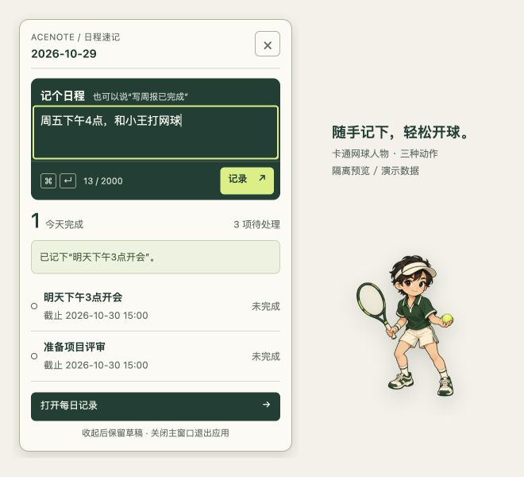

# 浮窗日程输入与人物桌宠：交付记录

历史版本记录：当前窗口入口与退出规则以 `../spec/SPEC-floating-first.md` 为准，大窗口关闭不再退出应用。
依据：`../spec/SPEC-floating-capture.md`，2026-10-29 用户直接要求实施。

- [x] 为浮窗开放最小的提交、原 intake 重试、转新待办、候选确认接口，复用主窗口生命周期服务。
- [x] 浮窗输入日程、快捷键和中文组合保护；成功清空，失败保留，候选在浮窗内确认。
- [x] 浮窗改为约 360×560，按实际工作区缩小与定位；收起后复用同一 renderer 保留会话草稿，重开时跟随桌宠重新定位。
- [x] 输入/处理中失焦不丢上下文；空闲无草稿时失焦收起；忙碌时阻止重复提交和关闭。
- [x] 使用内置 imagegen 生成同一网球人物的持拍、击球、庆祝三态，接入“击球 → 庆祝 → 待机”。
- [x] 保留旧占位素材，新人物 PNG 随应用本地打包；补充素材说明、原始路径与完整提示词。
- [x] 为浮窗交互、最小 preload 接口、窗口复用/边界和人物动效增加回归测试。
- [x] lint、typecheck、全量测试、覆盖率、build、格式与 diff 检查。
- [x] 隔离预览中直接输入并提交“明天下午3点开会”，验证成功提示、清空草稿和今日列表刷新。
- [x] 重启开发应用并核对桌面进程、渲染服务和本地解析服务。
- [ ] macOS/Windows 原生窗口的完整交互验收（原生自动化此前连接超时，本轮未标记为已通过）。

## 检查结果

| 项目                | 结果                                                                                |
| ------------------- | ----------------------------------------------------------------------------------- |
| `npm run lint`      | 通过                                                                                |
| `npm run typecheck` | 三个工作区通过                                                                      |
| `npm test`          | 34 个文件、120 项通过：desktop 101、server 8、contracts 11                          |
| 桌面覆盖率          | 语句 92.17%、分支 84.82%；已将窗口管理器加入覆盖范围，未降低阈值                    |
| 窗口管理器覆盖率    | 语句 80.47%、分支 80.00%；覆盖收起复用、重开定位、小屏幕/负屏幕坐标、关闭主窗口退出 |
| `npm run build`     | 三个 renderer、多 preload、主进程及 server/contracts 构建通过                       |
| PNG 校验            | 三张均为 512×512 RGBA，alpha 像素范围 0–255；idle 185685B、hit 208814B、ace 165732B |
| 隔离预览            | 360×560 浮窗可输入、提交、显示结果和更新列表；新人物可见；全部使用演示数据          |

测试前按 README 工作流重建 Node 版本的 `better-sqlite3`；应用重启时由原有 `npm run dev` 自动重建 Electron 版本。未新增依赖或修改数据库规则，没有向真实数据库写入演示日程。

## 使用与素材

单击桌宠打开日程速记，输入时间和事项，点击“记录”或使用 Cmd/Ctrl+Enter；也支持“某事项已完成”。收起浮窗保留当前应用会话的草稿，关闭主窗口仍会退出整个应用。

人物素材保存在 `apps/desktop/resources/pet/tennis-player-{idle,hit,ace}.png`，由内置 imagegen 生成并用系统工具规范化尺寸。完整提示词与源图路径见 `../apps/desktop/resources/pet/ASSETS.md`。

## 限制

草稿保留范围为本次应用会话；尚未提交的草稿不会因应用退出而写入长期存储。原生点击穿透、多显示器实际操作及系统缩放需在相应环境实测；窗口位置/复用已通过 mock 测试，不能代替原生验收。
