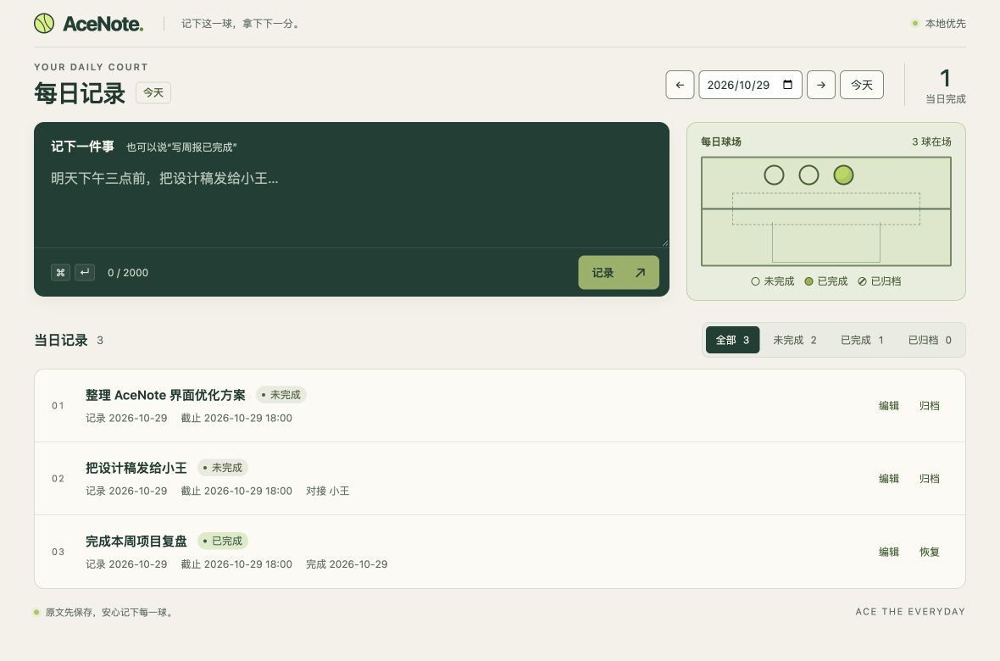
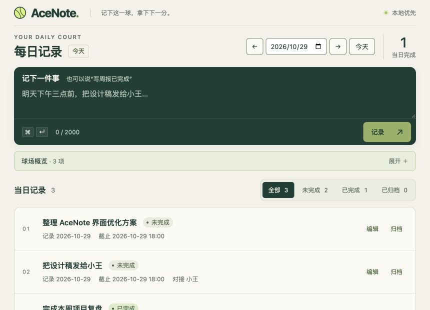

# AceNote 界面优化验证记录

日期：2026-10-29。依据：`../spec/SPEC-ui-polish.md`、`plan-ui-polish.md`、`todo-ui-polish.md`。

## 交付状态

渲染层实现、自动检查和浏览器布局验证已完成。原生 macOS/Windows 交互、实际系统缩放和断网冷启动尚未验收，不标记为全部验收通过。

保留既有深绿、奶油色和网球主题；没有修改数据库、主进程服务、IPC 契约、窗口尺寸、桌宠 PNG 或任务业务规则，也没有新增依赖。旧 capture/editor/reparse 流程继续通过回归测试。

## 主要变化

- 主窗口改为紧凑工作台，日期/统计前置，输入和球场在宽窗口并排，窄/矮窗口可展开球场。
- 系统字体、共享视觉变量、可见键盘焦点和更易读的操作字号；移除 Google Fonts 请求。
- 状态筛选与计数基于同一份按日记录，完成统计保留实际完成日期口径。
- 日期请求加入先后保护；区分查询失败、当天为空和筛选无结果；失败不丢草稿。
- 输入支持 Cmd/Ctrl+Enter、中文组合保护和同步提交锁；重试使用原 intake。
- 编辑和候选弹窗统一焦点约束、Esc、返回焦点和忙碌保护；候选失败保留选择。
- 提醒关闭失败可重试；今日浮窗明确加载失败，保持只读和 7 项上限。
- 桌宠长消息及关闭按钮移到 220×220 可见范围；保留现有资源与拖动、单击、双击行为。

## 工程检查

| 命令                                                 | 结果                                                                                     |
| ---------------------------------------------------- | ---------------------------------------------------------------------------------------- |
| `npm run lint`                                       | 通过                                                                                     |
| `npm run typecheck`                                  | 三个工作区通过                                                                           |
| `npm test`                                           | 32 个文件、109 项通过：desktop 27 文件/90 项，server 2 文件/8 项，contracts 3 文件/11 项 |
| `npm run test:coverage --workspace @acenote/desktop` | 90 项通过；语句 93.10%、分支 84.81%、函数 85.87%                                         |
| `npm run build`                                      | 主窗口、桌宠、今日浮窗以及 server/contracts 均构建通过                                   |
| `git diff --check`                                   | 通过                                                                                     |

覆盖率为配置范围内的汇总结果，达到现有语句/分支 80% 的全局门槛；个别文件仍低于 80%，没有降低门槛或剔除相关文件。新增输入、弹窗、今日浮窗和桌宠组件已纳入覆盖率范围。

第一次全量运行发现 `better-sqlite3` 为 Electron ABI 130，而当前 Node 24 测试需要 ABI 137。执行 `npm rebuild better-sqlite3` 后复测通过；没有修改依赖版本或 lockfile。后续 `npm run dev` 会按原有脚本重新构建 Electron 所需原生模块。

新增行为验证包括：日期响应乱序、筛选不重新请求、查询失败重试、快捷键重复提交、中文输入组合、提交/识别失败保留草稿、候选冲突、弹窗 Tab/Esc/焦点恢复、提醒关闭失败、今日浮窗刷新/清理和桌宠点击/拖动/长消息关闭。

## 浏览器与布局检查

预览使用当前 renderer、临时 Vite 服务和隔离的内存 API。三条基础任务均为演示数据，不连接真实 SQLite、解析服务或 DeepSeek。

| 场景                              | 结果                                                                                                        |
| --------------------------------- | ----------------------------------------------------------------------------------------------------------- |
| 1180×780 内容视口，3 条短标题任务 | 第一条从 y≈1102 提前至 y≈436；三条底部分别约 522/608/694px，均完整出现在首屏；页面宽度 1180px               |
| 860×620 内容视口                  | 球场默认收起；第一条始于 y≈415，前两条底部约 501/587px；页面宽度 860px，无横向溢出                          |
| 1440×900 内容视口、当天无记录     | 内容限宽居中；球场和列表均展示真实空状态                                                                    |
| 688×496 内容视口、约 200 字长标题 | 用于检查 860×620 在 125% 缩放下的等效可用宽度；页面宽度 688px，操作区仍在视口内。这不等同于实际系统缩放验收 |
| 25 条任务，宽窗口                 | 24 个球可见、点击区 32×32px；实测包围框无重叠，显示剩余 1 项                                                |
| 球场展开/收起及编辑 Esc           | 展开/收起正常；Esc 关闭后焦点恢复到原“编辑”按钮                                                             |
| 今日浮窗 300×390、8 条任务        | 渲染 7 项并提供剩余数量；列表可滚动，底部按钮位于约 y=367px；无横向溢出                                     |
| 今日浮窗查询失败                  | 明确显示失败和重试，不伪装成当天没有任务                                                                    |
| 桌宠 220×220、长消息              | 气泡边界约 x=8–212、y=6–118；关闭按钮 x=174–206、y=12–44，完全可见；关闭消息不会触发角色操作                |

核心次文字 `#5d6e63` 对奶油底对比度约 4.80:1，球场文字约 5.95:1，输入占位文字约 6.39:1；焦点指示约 3.57:1，日期/输入边界约 3.51:1。主界面、浮窗和桌宠使用共享系统字体。源文件检查没有远程字体/视觉资源 URL；弱动态规则已实现，真实断网启动和系统偏好变化仍需原生检查。

### 预览截图

默认尺寸（演示数据）：

最小尺寸（演示数据）：

## 规格验收对应

| 验收项  | 当前证据与限制                                                                                      |
| ------- | --------------------------------------------------------------------------------------------------- |
| A01     | 浏览器默认/最小尺寸通过；原生外框与标题栏待验证                                                     |
| A02     | 浏览器折叠、展开、断点切换及筛选通过                                                                |
| A03     | 核心字体、点击区、对比度计算、键盘组件测试及浏览器检查通过；原生系统控件待检查                      |
| A04     | 系统字体与本地资源构建通过、源码无远程视觉请求；实际断网冷启动待验证                                |
| A05–A08 | 日期、筛选、统计、输入及失败恢复的组件/业务回归通过                                                 |
| A09     | 自动测试与浏览器实际 Esc/焦点恢复通过                                                               |
| A10     | 提醒失败恢复、浮窗 7/8 项和错误状态通过；提醒层级低于弹窗，容器具有限高滚动；原生窗口显示效果待检查 |
| A11     | 浏览器气泡边界、关闭交互与组件回归通过；原生透明点击穿透及系统弱动态偏好待验证                      |
| A12     | lint、typecheck、全量测试、覆盖率与 build 通过                                                      |

## 待验收项

1. macOS 原生：已尝试启动隔离 Electron 预览，但桌面自动化以应用路径和 bundle ID 连接均超时，未获得可靠窗口检查结果。预览进程已结束；原生标题栏、透明区穿透、气泡关闭和退出行为不能标记为通过。
2. Windows 原生：当前无 Windows 验证环境，系统字体、日期控件和桌宠窗口待实测。
3. 实际 125% 缩放、系统减少动态效果设置及断网冷启动：当前只完成等效内容宽度、样式实现和本地资源检查，实际系统行为待验证。

本轮没有为规避这些限制修改权限、窗口结构或安全设置。
